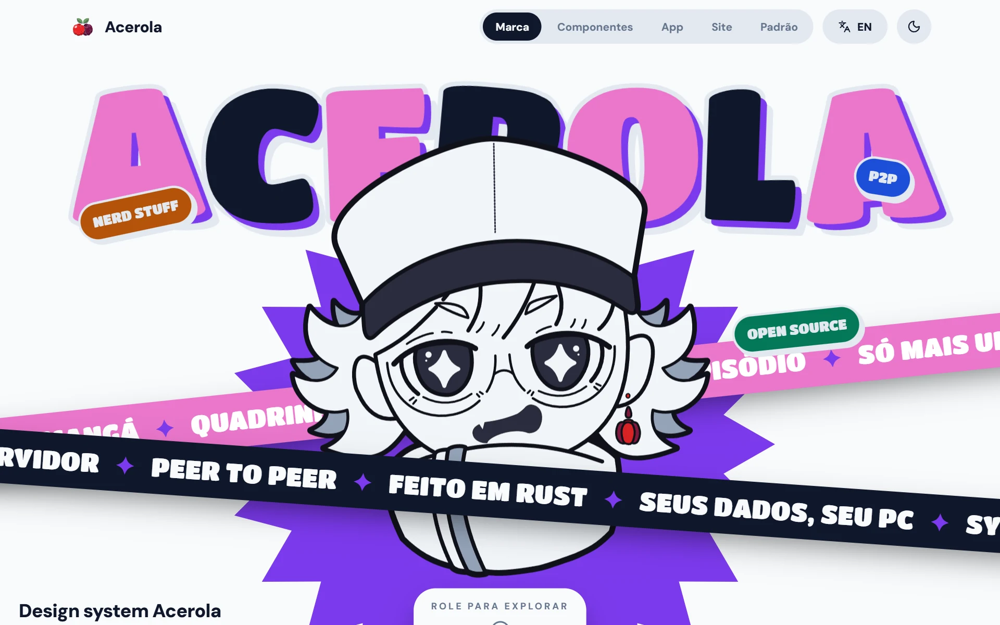
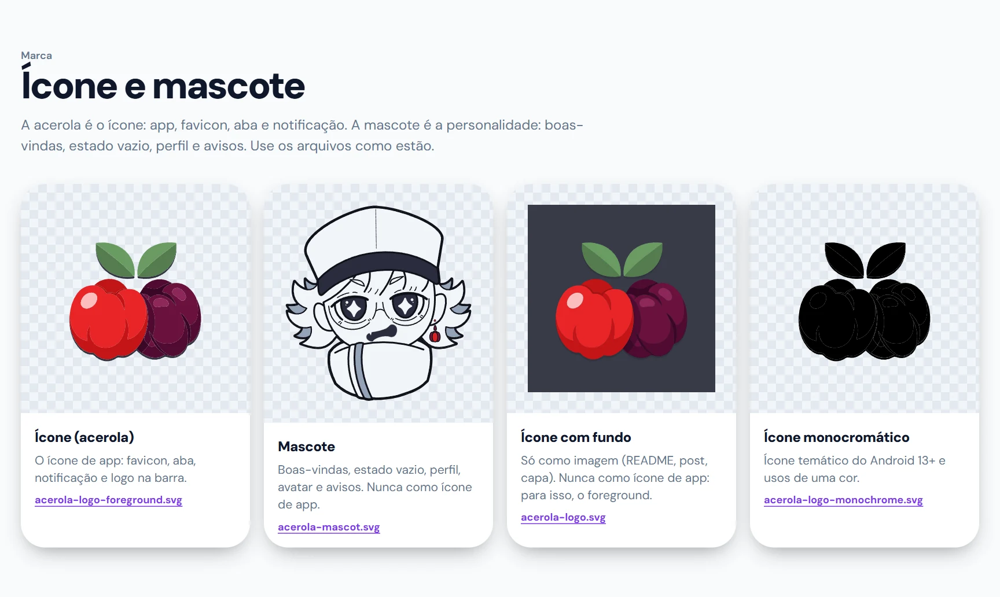
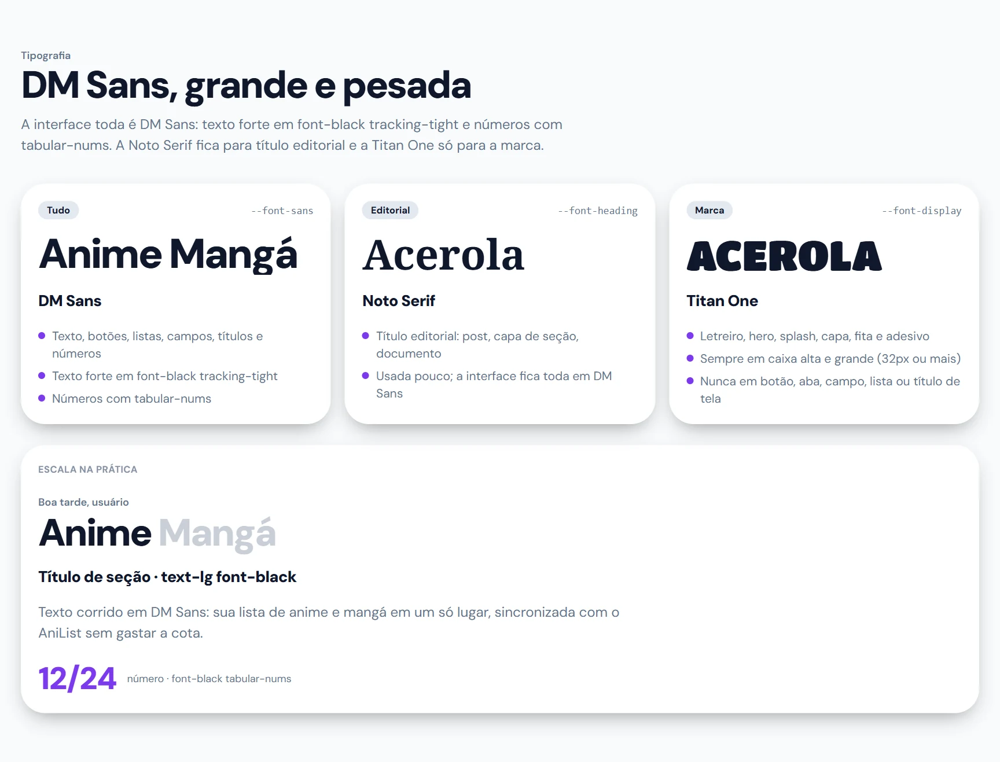
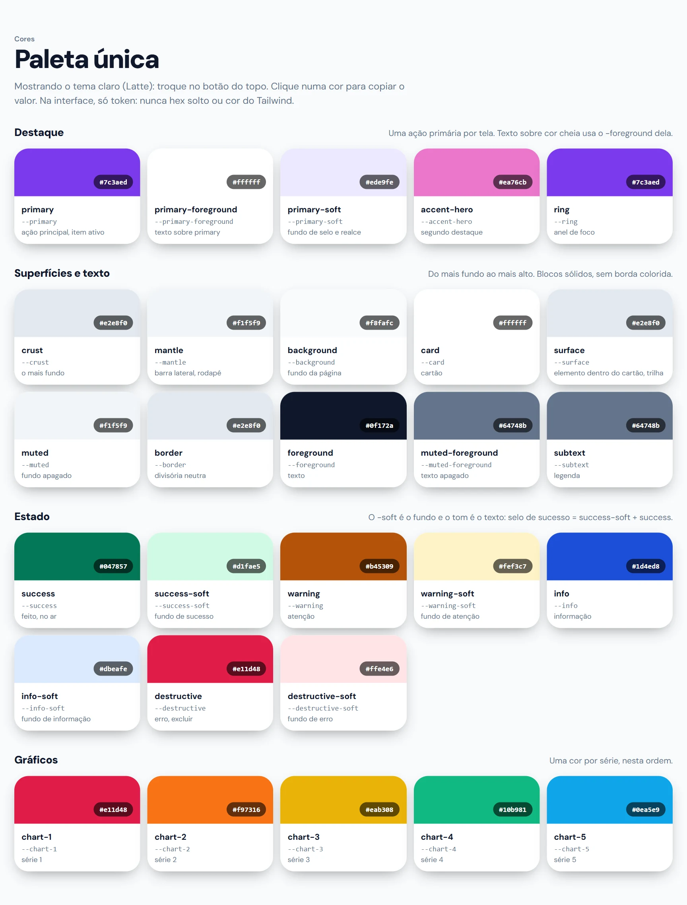
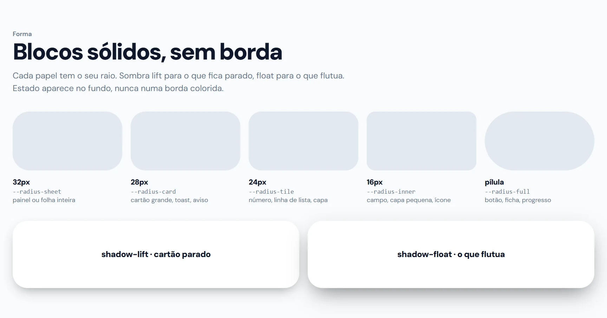
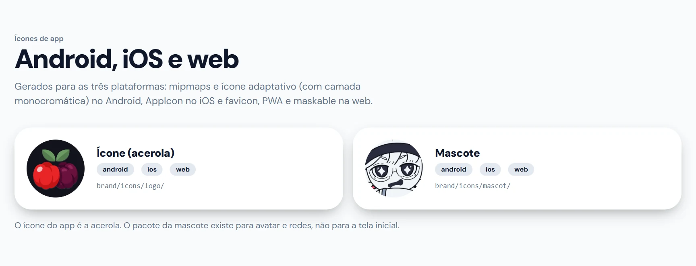
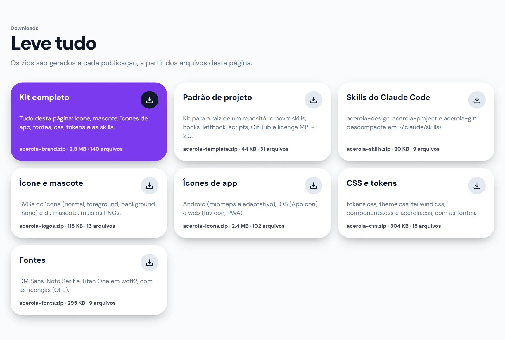

# Marca

Blocos sólidos, cantos muito redondos, tipografia grande e pesada, cor só onde significa algo.
Escuro é o padrão. Divertido na marca (mascote, Titan One, adesivo, fita) e sério na interface
(DM Sans, tokens e espaço). As regras completas estão na skill `acerola-design`.

<picture>
  <source media="(prefers-color-scheme: dark)" srcset="github/ptbr/prints/dark/home-hero.webp">
  
</picture>

## Ícone e mascote

A acerola é o ícone; a mascote é a personalidade. O ícone de app é sempre o
`acerola-logo-foreground.svg`; o `acerola-logo.svg`, com fundo, é só imagem (README, post). A
mascote entra em boas-vindas, vazio, perfil, aviso e hero, e nunca vira ícone de app. Nenhum dos
dois é recolorido, esticado, girado ou redesenhado.

<picture>
  <source media="(prefers-color-scheme: dark)" srcset="github/ptbr/prints/dark/home-brand.webp">
  
</picture>

## Tipografia

| Fonte | Uso |
| --- | --- |
| **DM Sans** | tudo da interface: texto, botão, lista, título, número |
| **Noto Serif** | título editorial (post, documento). Raro |
| **Titan One** | só a marca: letreiro, hero, splash, capa, fita, adesivo, palco da tela de erro |

<picture>
  <source media="(prefers-color-scheme: dark)" srcset="github/ptbr/prints/dark/home-typography.webp">
  
</picture>

## Cores

Uma paleta só, por papel: fundos (`crust` → `surface`), texto, ação e destaque (`primary`,
`accent-hero`), estado (`success`, `warning`, `info`, `destructive`, cada um com `-soft`) e
gráfico (`chart-1` … `chart-5`). Na interface só se usa token, nunca hex solto ou cor do Tailwind.
No site, clicar numa cor copia o valor.

<picture>
  <source media="(prefers-color-scheme: dark)" srcset="github/ptbr/prints/dark/home-colors.webp">
  
</picture>

## Forma

Raios `sheet` (32px), `card` (28px), `tile` (24px), `inner` (16px) e `full`. Duas sombras,
`shadow-lift` e `shadow-float`, e nenhuma borda colorida.

<picture>
  <source media="(prefers-color-scheme: dark)" srcset="github/ptbr/prints/dark/home-shape.webp">
  
</picture>

## Ícones de app

Os ícones para Android, iOS e web, gerados do ícone foreground.

<picture>
  <source media="(prefers-color-scheme: dark)" srcset="github/ptbr/prints/dark/home-icons.webp">
  
</picture>

## Downloads

Tudo o que o site entrega, em zip: a marca, os ícones e o kit de projeto
(`acerola-template.zip`).

<picture>
  <source media="(prefers-color-scheme: dark)" srcset="github/ptbr/prints/dark/home-downloads.webp">
  
</picture>
