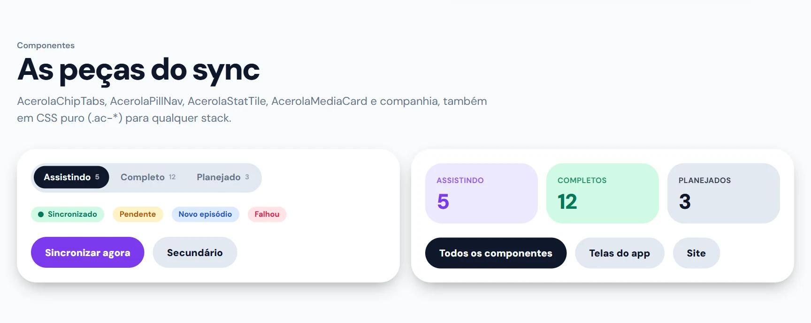
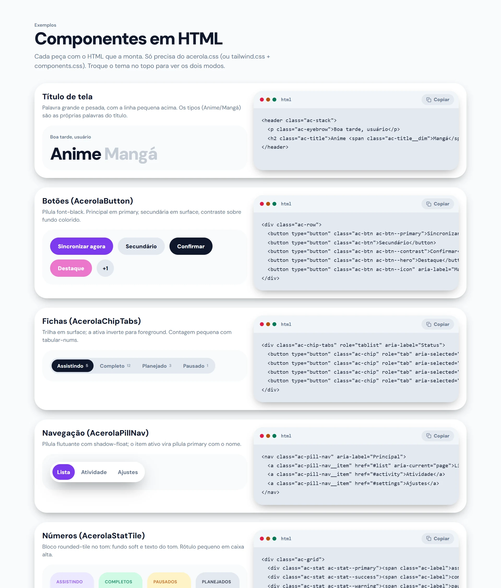

# Componentes

Em Svelte, cada peça mora em `lib/components/acerola-<nome>/`. Fora do Svelte, as classes `.ac-*`
do `components.css` são o modelo, e funcionam em qualquer HTML.

## As peças do sync

| Peça | Regra |
| --- | --- |
| Botão | pílula `h-11`/`h-12`, `font-black`; principal `bg-primary`, secundário `bg-surface` |
| Abas | trilha `bg-surface`, ativa `bg-foreground text-background`, desliza com GSAP |
| Navegação | pílula flutuante; o item ativo vira pílula `bg-primary` com o nome |
| Número | bloco com tom: fundo `-soft` e texto do tom |
| Capa | 2/3, `rounded-tile`, ficha sobre scrim, progresso `bg-primary` |
| Toast/aviso | `rounded-card`, sem borda, fundo e texto no tom do tipo |
| Vazio | mascote + título `font-black` + uma frase + uma ação |

<picture>
  <source media="(prefers-color-scheme: dark)" srcset="github/ptbr/prints/dark/home-components.webp">
  
</picture>

## Componentes em HTML

A página **Componentes** do site (`/examples/`) mostra cada classe `.ac-*` com o código para
copiar. O print é o começo da página.

<picture>
  <source media="(prefers-color-scheme: dark)" srcset="github/ptbr/prints/dark/components.webp">
  
</picture>

## Usar

```html
<link rel="stylesheet" href="https://cdn.acerola.app/brand/css/acerola.css" />
```

```css
@import 'tailwindcss';
@import 'https://cdn.acerola.app/brand/css/tailwind.css';
@import 'https://cdn.acerola.app/brand/css/components.css';
```
