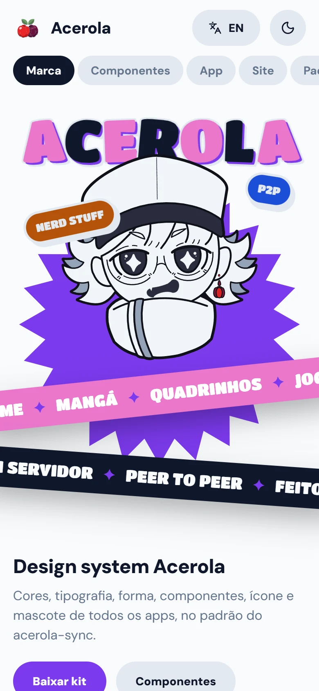
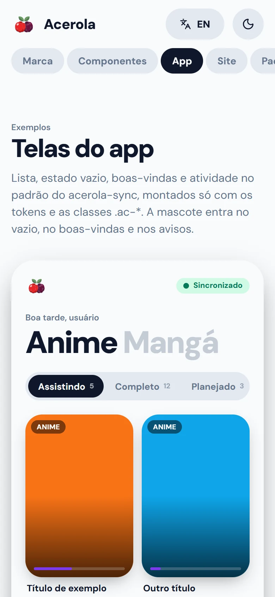
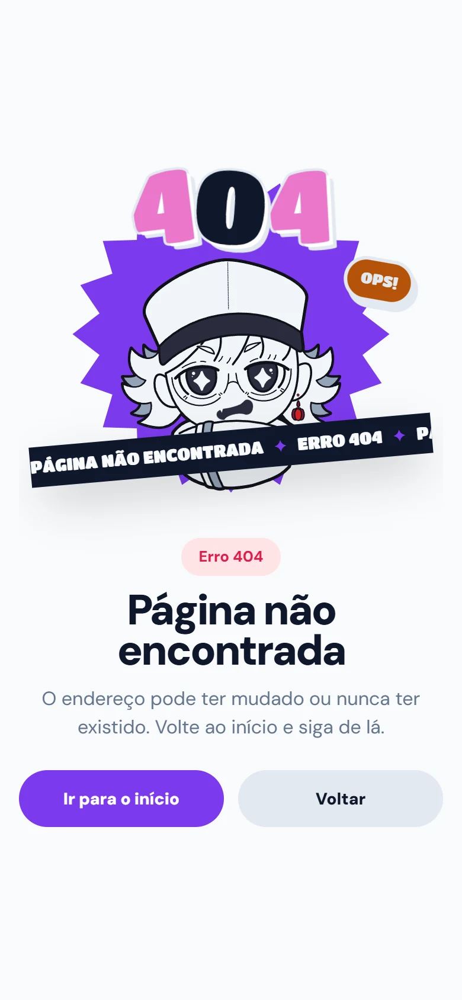

# Telas

Exemplos montados só com os tokens e as classes `.ac-*`, para todo app copiar.

## Telas do app

Lista, estado vazio, boas-vindas e atividade, no padrão do acerola-sync. Toda tela que carrega dado
tem os quatro estados desenhados: carregando (esqueleto), vazio (mascote e uma ação), erro e
pronto.

<picture>
  <source media="(prefers-color-scheme: dark)" srcset="github/ptbr/prints/dark/app-screens.webp">
  
</picture>

## Tela de erro

Uma tela só para qualquer erro (404, 401, 403, 500, 503, sem conexão), sem barra de navegação nem
rodapé. De um lado o texto e duas ações; do outro o palco da marca, com o código em Titan One, a
mascote, a fita e o adesivo. Em 4xx a ação principal é "Ir para o início"; em 5xx, tempo esgotado e
sem conexão, "Tentar de novo".

<picture>
  <source media="(prefers-color-scheme: dark)" srcset="github/ptbr/prints/dark/app-error.webp">
  
</picture>

É a mesma tela que o site mostra num endereço que não existe:

<picture>
  <source media="(prefers-color-scheme: dark)" srcset="github/ptbr/prints/dark/error-404.webp">
  
</picture>

## Site

Um site de produto no padrão: hero de marca, o workspace e os passos.

<picture>
  <source media="(prefers-color-scheme: dark)" srcset="github/ptbr/prints/dark/site.webp">
  
</picture>

## No celular

<table>
  <tr>
    <td width="33%">
      <picture>
        <source media="(prefers-color-scheme: dark)" srcset="github/ptbr/prints/dark/mobile-home.webp">
        
      </picture>
    </td>
    <td width="33%">
      <picture>
        <source media="(prefers-color-scheme: dark)" srcset="github/ptbr/prints/dark/mobile-app.webp">
        
      </picture>
    </td>
    <td width="33%">
      <picture>
        <source media="(prefers-color-scheme: dark)" srcset="github/ptbr/prints/dark/mobile-error.webp">
        
      </picture>
    </td>
  </tr>
</table>
