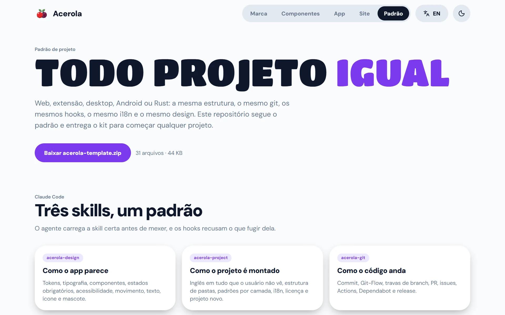
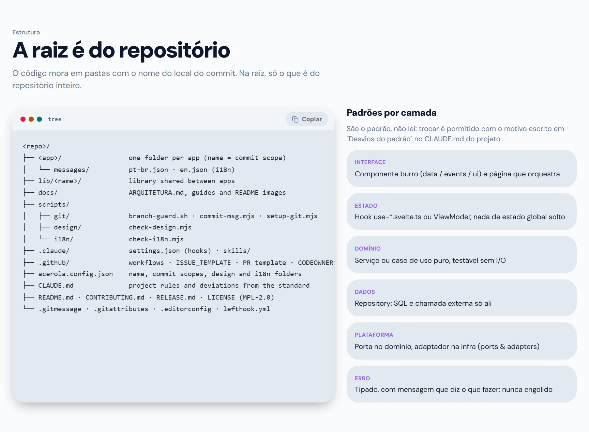
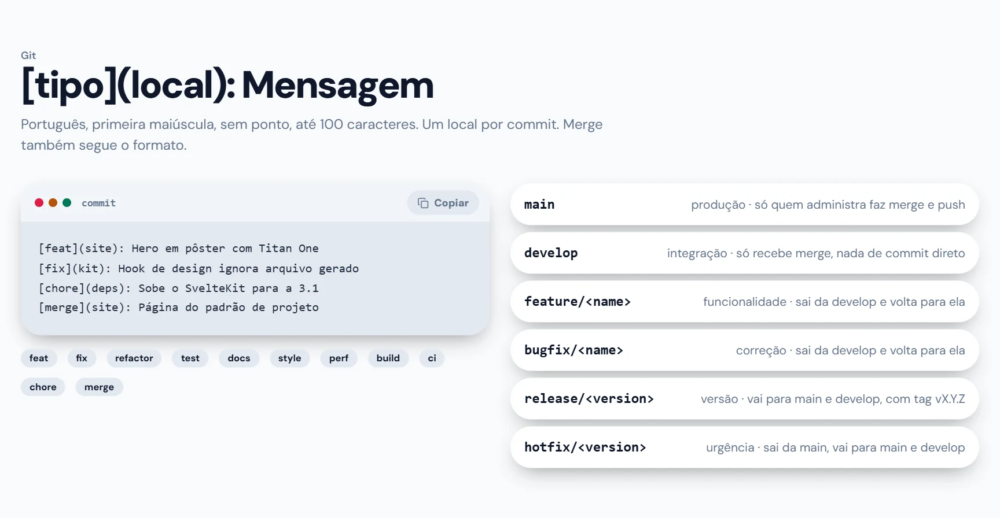
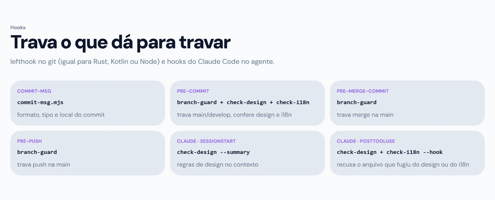
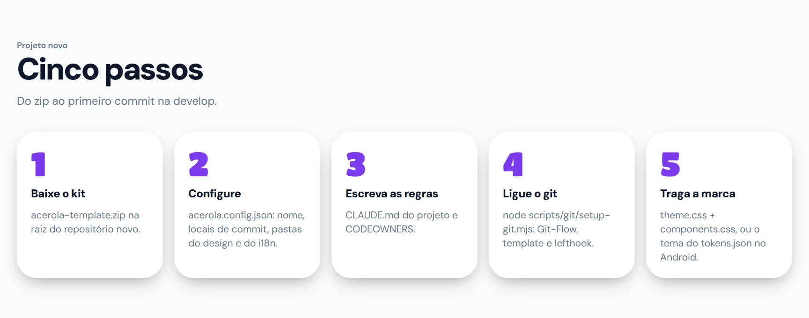

# Padrão de projeto

Todo projeto Acerola segue o mesmo padrão, em qualquer stack. Ele vive em três skills do Claude Code
e sai como kit (`acerola-template.zip`).

<picture>
  <source media="(prefers-color-scheme: dark)" srcset="github/ptbr/prints/dark/standard-hero.webp">
  
</picture>

| Skill | Cobre |
| --- | --- |
| `acerola-design` | tela, componente, cor, fonte, ícone, peça de marca |
| `acerola-project` | estrutura de pasta, camada, módulo, licença, projeto novo |
| `acerola-git` | commit, branch, PR, issue, workflow, release |

## A raiz é do repositório

O código mora em pastas com o nome do local do commit; a raiz guarda o que é do repositório. Tudo
o que o usuário não vê é em inglês (pastas, arquivos, rotas, código, banco, logs, comentários), e
todo texto de tela passa pelo i18n.

<picture>
  <source media="(prefers-color-scheme: dark)" srcset="github/ptbr/prints/dark/standard-structure.webp">
  
</picture>

## Git

Commit `[tipo](local): Mensagem`, um local por commit. Git-Flow com `main`, `develop` e branches
de trabalho, e só três branches vivas: `main`, `develop` e a de trabalho do momento. Tag `vX.Y.Z`
é a única coisa que publica.

<picture>
  <source media="(prefers-color-scheme: dark)" srcset="github/ptbr/prints/dark/standard-git.webp">
  
</picture>

## Hooks

O lefthook trava o que dá para travar: formato do commit, commit direto na `main`/`develop`,
design e i18n antes do commit.

<picture>
  <source media="(prefers-color-scheme: dark)" srcset="github/ptbr/prints/dark/standard-hooks.webp">
  
</picture>

## Começar um projeto

<picture>
  <source media="(prefers-color-scheme: dark)" srcset="github/ptbr/prints/dark/standard-start.webp">
  
</picture>
